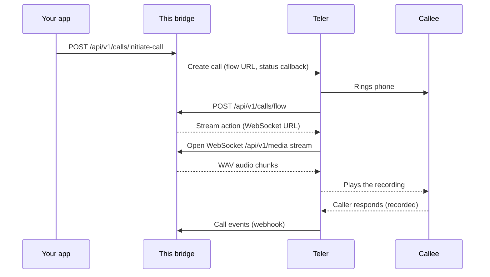

# Teler WAV Bridge

[](LICENSE)    [](https://frejun.com/docs/teler/)

A reference implementation demonstrating how to stream a pre-recorded WAV file to a live phone call using Teler's Media Streaming Bridge over WebSockets, while recording and collecting the caller's responses.

## What is Teler?

Teler is a programmable voice API by FreJun. It handles telephony infrastructure, phone numbers, call routing, and real-time audio streaming, allowing developers to build custom voice workflows directly on phone calls.

Learn more at [FreJun-Teler](https://frejun.com/teler/)

---

## Overview

This project demonstrates a simple but powerful voice workflow:

1. Initiate an outbound phone call.
2. Stream a pre-recorded WAV file to the callee over WebSockets.
3. Capture the callee's responses in real time.
4. Store the call recording for later review and analysis.

Unlike AI voice agents, there is no real-time speech generation or conversational AI involved. The caller hears a pre-recorded audio message, and their responses are recorded and made available after the call.

This makes the integration lightweight, predictable, and ideal for one-way announcements, surveys, campaigns, and response collection workflows.

---

## Who is this for?

This integration is ideal for teams that want to automate voice outreach without deploying AI agents.

### Common Use Cases

#### Appointment Reminders

Play a pre-recorded reminder and collect customer confirmations or responses.

#### Recruitment & Candidate Screening

Play screening questions and collect recorded candidate answers.

#### Customer Feedback Campaigns

Gather voice feedback without requiring a live agent or AI assistant.

## How it works



1. Your app calls `POST /api/v1/calls/initiate-call`. The bridge asks Teler to place the call, passing its own flow and webhook URLs.
2. When the call connects, Teler requests `/api/v1/calls/flow`, and the bridge answers with a stream action that points to its WebSocket.
3. Teler opens the WebSocket at `/api/v1/media-stream`, and the bridge streams the WAV file into the call in chunks.
4. The caller's responses are recorded by Teler. Call events arrive at `/api/v1/webhooks/receiver`.

## Features

* Stream pre-recorded WAV files directly into live phone calls over WebSockets.
* Capture and record caller responses.
* Dockerized deployment.
* Access recordings through the FreJun Dashboard or Recording API.

---

## Accessing Recordings

All caller responses are recorded and can be accessed through:

### FreJun Teler Dashboard

View, listen to, and manage call recordings directly from the dashboard.

### Recording API

Retrieve recordings programmatically using the Recording API.

Recording API Documentation:

https://frejun.com/docs/teler/api-reference/

---

## Prerequisites

- Node.js 18+
- Docker & Docker Compose
- A Teler API Key (get one at https://platform.frejun.ai)
- An ngrok account and auth token

### Runtime and network requirements

- **Runtime:** Docker and Docker Compose (recommended). To run without Docker: Node.js 20 and npm (the Docker image uses `node:20-alpine`).
- **Public HTTPS/WSS endpoint:** Teler must reach this server from the internet for the flow URL, the media WebSocket and webhooks. The Docker setup uses ngrok for this; in production, use your own domain with TLS.
- **Outbound internet access** from the server to the Teler API and to the provider's API.
- **Ports:** `8000` (app) and `4040` (ngrok inspector) must be free on the host when using Docker Compose.


---

## Setup

### Clone and Configure

```bash
git clone https://github.com/frejun-tech/teler-wav-bridge.git
cd teler-wav-bridge

cp .env.example .env
```

Update the `.env` file with your credentials.

### Run with Docker

```bash
docker compose up -d --build
```

### Run without Docker (local development)

```bash
npm install
npm run dev          # development, runs src/index.ts directly
# or
npm run build && npm run serve   # compiled build, runs dist/index.js
```

In a second terminal, run `ngrok http 8000`. With `NODE_ENV` set to anything other than `production`, the bridge detects the tunnel from `http://localhost:4040` automatically.

### Verify it is running

```bash
curl http://localhost:8000/health
curl http://localhost:8000/ngrok-status
```

Then place a test call with the request in **Call Initiation Example**.

---

## Environment Variables

| Variable          | Description                          | Default  |
| ----------------- | ------------------------------------ | -------- |
| TELER_SAMPLE_RATE | Audio sample rate used for streaming | 8k       |
| TELER_API_KEY     | Your Teler API Key                   | Required |
| NGROK_AUTHTOKEN   | Your ngrok Auth Token                | Required |

### Required vs optional settings

These values are taken from the code (`src/core/config.ts`). Where this table and the table above differ, the code is what runs.

| Variable | Required | Default | Description |
|---|---|---|---|
| `TELER_API_KEY` | Required | — | Teler API key, used to place calls through the Teler API |
| `NGROK_AUTHTOKEN` | Required with Docker | — | ngrok auth token, read by the `ngrok` container in `docker-compose` (not by the app itself) |
| `TELER_SAMPLE_RATE` | Optional | `8k` | Sample rate requested from Teler for the media stream |
| `SERVER_DOMAIN` | Optional | auto-detected | Public hostname of this server, without `https://`. Auto-detected from ngrok when it is running; set it yourself when deploying without ngrok |
| `PORT` | Optional | `8000` | Port the server listens on |
| `NODE_ENV` | Optional | `development` | `production` makes ngrok detection use the `ngrok` container (`http://ngrok:4040`); any other value uses `http://localhost:4040` |

---

## Audio Requirements

For best results, audio files should be:

* WAV format
* PCM S16LE
* Mono
* 8000 Hz sample rate

This format aligns with standard telephony audio and ensures optimal playback quality during calls.

## API Endpoints

### Health & Status

* `GET /` - Health check and server information
* `GET /health` - Service status
* `GET /ngrok-status` - Current ngrok status and public URL

### Calls

* `POST /api/v1/calls/initiate-call` - Initiate an outbound call
* `POST /api/v1/calls/flow` - Retrieve call flow configuration

### Media Streaming

* `WebSocket /api/v1/calls/media-stream`

Streams pre-recorded WAV audio to the call and receives caller audio events.

### Webhooks

* `POST /api/v1/webhooks/receiver`

Receives call status and media events from Teler.

---

## Call Initiation Example

```bash
curl -X POST "https://your_ngrok_domain/api/v1/calls/initiate-call" \
  -H "Content-Type: application/json" \
  -d '{
    "fromNumber": "+918064xxx",
    "toNumber": "+919967xxx"
  }'
```

---

## Troubleshooting

**`initiate-call` returns an authentication error from Teler.**
Check `TELER_API_KEY` in `.env`, then restart the container so it picks up the change. Keys are managed in the [Teler dashboard](https://platform.frejun.ai).

**The phone rings, but there is silence after answering.**
Teler could not reach the flow URL or the WebSocket. Open `/ngrok-status` and confirm a public URL is listed. If you are not using ngrok, set `SERVER_DOMAIN` to your public hostname without `https://`.

**`/ngrok-status` shows no tunnel.**
Check that `NGROK_AUTHTOKEN` is set and look at the ngrok container logs (`docker compose logs ngrok`). The free ngrok plan gives a new URL on every restart, so place calls only after the tunnel is up.

**The connection to WAV playback fails or closes immediately.**
Check the WAV playback credentials in `.env` (see **Required vs optional settings**) and the app logs (`docker compose logs app`) for the provider's error message.

**Running in Docker, the app cannot find the ngrok URL.**
Set `NODE_ENV=production` so the bridge looks for the `ngrok` container instead of `localhost:4040`.

**`Bind for 0.0.0.0:8000 failed: port is already allocated`.**
Another process is using port 8000 or 4040. Stop it, or change the host port mapping in `docker-compose`.

**The recording plays distorted.**
Check that your WAV file matches the format described in **Audio Requirements**.

## Security

- **Keep secrets out of git.** Store keys only in `.env`, which is listed in `.gitignore`. Never commit real keys, and use placeholders in examples and issues.
- **Rotate keys** if you suspect a key was exposed, and use separate keys for development and production.
- **Protect the call-initiation endpoint.** `POST /api/v1/calls/initiate-call` has no authentication in this reference code, so anyone who can reach your public URL can place calls billed to your Teler account. Before exposing the server, add authentication (an API key header, for example) or restrict access by IP.
- **The flow, media and webhook endpoints are not verified** in this reference code. In production, keep the server behind your own domain and validate incoming requests.
- **Use ngrok only for development.** In production, deploy behind your own domain with TLS (`https://` and `wss://`).
- **Call recording is on by default** in this bridge. Make sure you have the consent your jurisdiction requires, or turn recording off.
- **Logs can contain call details** such as phone numbers and transcripts. Handle logs as personal data.
- **Report security issues privately** to support@frejun.com rather than in a public GitHub issue.

## Contributing

- **Report a bug or request a feature:** open an issue at [github.com/frejun-tech/teler-wav-bridge/issues](https://github.com/frejun-tech/teler-wav-bridge/issues). Include steps to reproduce, the relevant logs (with keys removed) and your environment.
- **Submit a change:** fork the repository, create a branch, make your change, and open a pull request that describes what changed and how you tested it. Keep pull requests focused on one change.
- For questions about your Teler account, contact support@frejun.com.

## Related repositories

**Python bridges:** [cartesia](https://github.com/frejun-tech/teler-cartesia-bridge), [deepgram](https://github.com/frejun-tech/teler-deepgram-bridge), [devnagri](https://github.com/frejun-tech/teler-devnagri-bridge), [elevenlabs](https://github.com/frejun-tech/teler-elevenlabs-bridge), [gemini](https://github.com/frejun-tech/teler-gemini-bridge), [openai](https://github.com/frejun-tech/teler-openai-bridge), [ultravox](https://github.com/frejun-tech/teler-ultravox-bridge), [vapi](https://github.com/frejun-tech/teler-vapi-bridge)

**Node.js bridges:** [cartesia](https://github.com/frejun-tech/teler-cartesia-node-bridge), [deepgram](https://github.com/frejun-tech/teler-deepgram-node-bridge), [devnagri](https://github.com/frejun-tech/teler-devnagri-node-bridge), [elevenlabs](https://github.com/frejun-tech/teler-elevenlabs-node-bridge), [gemini](https://github.com/frejun-tech/teler-gemini-node-bridge), [openai](https://github.com/frejun-tech/teler-openai-node-bridge), [sarvam](https://github.com/frejun-tech/teler-sarvam-node-bridge), [ultravox](https://github.com/frejun-tech/teler-ultravox-node-bridge), [vapi](https://github.com/frejun-tech/teler-vapi-node-bridge)

**Other Teler references:** [teler-livekit-outbound](https://github.com/frejun-tech/teler-livekit-outbound), [teler-openai-sip-trunking](https://github.com/frejun-tech/teler-openai-sip-trunking)

**SDKs:** [teler-py](https://github.com/frejun-tech/teler-py) (Python), [teler-node](https://github.com/frejun-tech/teler-node) (Node.js)

## Documentation

- [Teler documentation](https://frejun.com/docs/teler/)
- [Quickstart](https://frejun.com/docs/teler/get-started/quickstart/)
- [Media Streaming Bridge](https://frejun.com/docs/teler/media-streaming/bridge/)
- [API reference](https://frejun.com/docs/teler/api-reference/)
- [FreJun Teler](https://frejun.com/teler/)
- [Teler dashboard](https://platform.frejun.ai)

## License

This project is licensed under the MIT License. See [LICENSE](LICENSE) for details.
